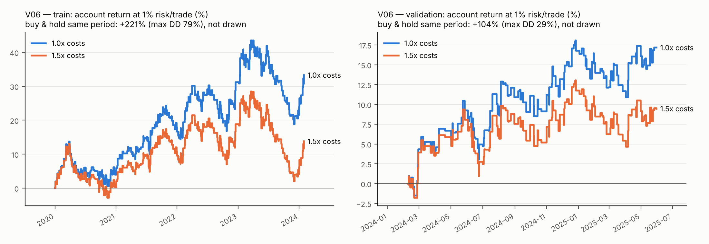
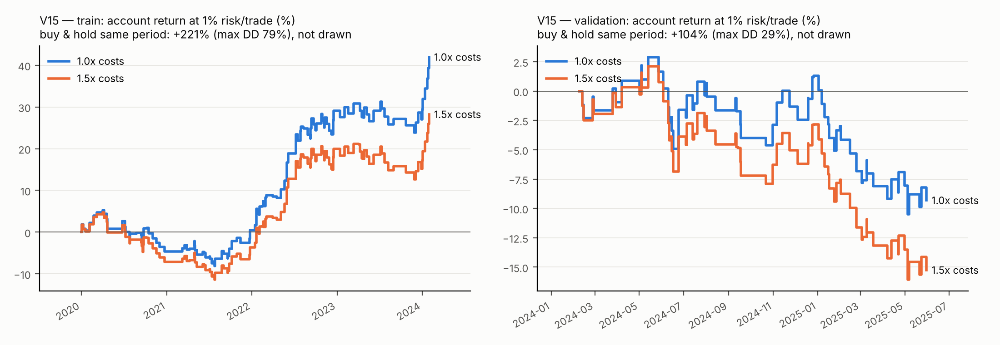
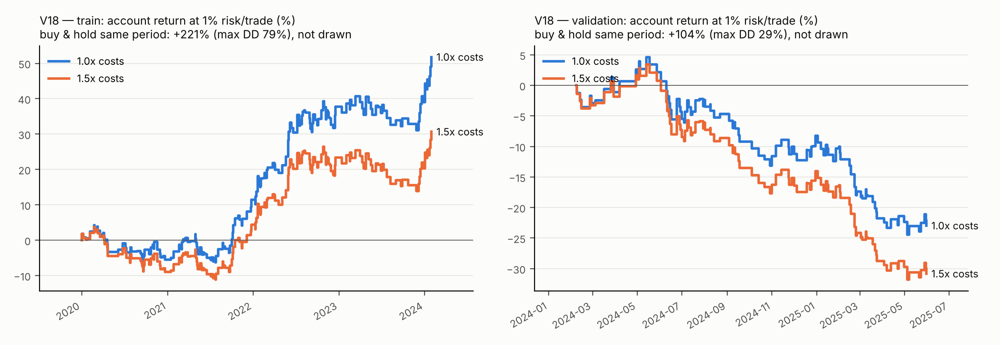

# FINAL REPORT — intraday BTCUSDT "institutional liquidity footprint" strategy

## Verdict: **FAIL — no edge found**

No strategy built from stop sweeps, liquidity raids, liquidation-cascade proxies, displacement or order-flow divergence
has a positive-expectancy edge after realistic costs that meets the pre-set criteria.
Because nothing passed Train + Validation + robustness, **the final holdout was never run and never downloaded** — it is still sealed.

The three numbers that matter:

1. **0 of 16** footprint event definitions (64 tests) reached the pre-registered significance bar on Train; **none** had a positive
   mean return after the 12 bps round-trip cost at the 5–60 minute horizons.
2. The best Train strategy ("spot-led 1H displacement", V15/V18: **+0.28R / +0.21R** per trade) **lost money on Validation
   (−0.13R / −0.23R)** and was indistinguishable from random entries there. It was a selection artefact.
3. The only effect that looks the same on Train and Validation is a weak continuation after a 1-hour displacement bar
   (V06: **+0.08R Train, +0.12R Validation at 1.0x costs; +0.04R / +0.07R at 1.5x**), below the +0.15R bar, with a confidence
   interval that includes zero, and with a deflated Sharpe probability of ~0.

Everything below is reproducible from committed code (`README.md` has the commands; seed 20261116).

---

## 1. What was tested

**Instrument / data.** BTCUSDT USDT-margined perpetual on Binance, 1-minute klines 2020-01-01 → 2025-05-31 (2.85 M bars, zero
missing minutes, 351 zero-volume minutes), realised funding (5,934 prints), 5-minute open interest (from 2020-09), spot 1m klines for
reference. Source: `data.binance.vision`. Resampled to 5m and 1H in code.

**Split (committed before any data was downloaded):**

| split | dates (UTC) | status |
|---|---|---|
| Train | 2020-01-01 → 2024-01-31 | used for all development |
| Validation | 2024-02-08 → 2025-05-31 | used once for the two frozen candidates, then for diagnostics (disclosed) |
| Final holdout | 2025-06-08 → 2026-10-31 | **never downloaded, never run** |

**Sessions (UTC):** Asia 00–07, London 07–13, New York 13–21, late 21–24.

**Cost model (fixed up front):** taker 5 bps/side, maker 2 bps/side, market slippage 1 bp/side, stop slippage 2 bps plus
gap-through, real funding at real timestamps. Round trip market-in/market-out = 12 bps; every test also at 1.5x (18 bps).
Fills: signal on a closed 5m bar → entry at the next 1m open plus slippage; stops fill at the stop or the bar open if gapped, plus
slippage; limit targets only when price trades through by a tick; stop assumed first if stop and target share a bar; one position at
a time; 1% risk per trade, leverage capped at 5x (stops were 70–260 bps, so liquidation at 5x — roughly 19% away — cannot be reached before the stop).

## 2. Phase 0 — event study (Train only)

Signed forward return from the next bar's open, compared with all bars in the same (year, hour, volatility tercile) cell;
day-clustered bootstrap. Full tables: `reports/event_study.md`, `reports/event_study_0b.md`.

| event | n | best horizon | gross bps | excess vs matched baseline [95% CI] | t | finding |
|---|---|---|---|---|---|---|
| Previous-day high/low sweep, fade | 4,657 | 15m | +0.5 | +0.5 [−1.0, +1.9] | 0.6 | no edge |
| Asia-range sweep, fade | 6,154 | 60m | −3.0 | −3.1 [−6.3, −0.1] | −1.9 | no edge (faintly the wrong way) |
| Equal highs/lows raid, fade | 902 | 15m | +1.2 | +1.2 [−1.3, +3.7] | 1.0 | no edge |
| 5m displacement, follow | 2,720 | 5m | −2.6 | −2.7 [−4.6, −0.7] | −2.7 | wrong sign, tiny |
| Cascade proxy, fade | 6,232 | 60m | +1.6 | +1.9 [−1.5, +5.1] | 1.1 | no edge |
| Cascade + open-interest drop, fade | 2,142 | 30m | +5.0 | +5.3 [+0.7, +10.1] | 2.2 | weak, under half the cost |
| Delta divergence at 4h extreme, fade | 762 | 30m | +3.0 | +3.4 [−0.3, +7.3] | 1.8 | no edge |
| NY open drive, follow | 407 | 15m | −5.3 | −5.4 [−10.8, −0.6] | −2.1 | wrong sign, weak |
| London open drive, follow | 218 | 30m | −5.2 | −5.4 [−21, +6.6] | −0.8 | no edge |
| *Phase 0b* extreme cascade (z>5, OI −1.5%), fade | 388 | 240m | +24.3 | +23.2 [+1.5, +47.4] | 2.0 | dose-response present, not significant |
| *Phase 0b* 1H displacement, follow | 405 | 240m | +19.6 | +18.4 [+1.2, +35.1] | 2.1 | weak |
| *Phase 0b* PD sweep with 1H trend bias | 301 | 30m | +7.5 | +7.6 [−0.8, +17.5] | 1.6 | no edge |

Pre-registered bar: |t| ≥ 3.3 (Bonferroni; 3.4 after Phase 0b). Largest |t| observed: 2.7. **Strictly, no event qualified as a strategy
component.** I carried the least-bad families into the strategy loop as an explicitly exploratory step.

Liquidation data: the archive has no liquidation feed for BTCUSDT, so "cascade" is a proxy (large move + volume spike + aggressive
flow, optionally an open-interest drop).

## 3. Strategy loop — 20 variants (limit 25)

All variants: fixed stop = k × ATR(1H, 14), fixed reward:risk, time stop, market entry at next 1m open. Expectancy in R at 1.0x costs,
Train, with 90% bootstrap CI. Full table incl. 1.5x, profit factor, drawdown, Sharpe/Sortino, losing streaks, long/short split and
baselines: `reports/summary.md`, `reports/variants.csv`. Per-trade lists: `reports/trades/`.

| id | idea | n | exp R [90% CI] | 1.5x | PF | random-entry mean R (p) |
|---|---|---|---|---|---|---|
| V01 | cascade (OI −1%) fade, 1 ATR, RR2, 4h | 762 | −0.246 [−0.32, −0.17] | −0.335 | 0.66 | −0.17 (0.97) |
| V02 | extreme cascade fade | 386 | −0.276 [−0.38, −0.17] | −0.363 | 0.63 | −0.17 (0.97) |
| V03 | mild cascade fade | 1,955 | −0.195 [−0.24, −0.15] | −0.283 | 0.71 | −0.17 (0.82) |
| V04 | 1H displacement follow, 1 ATR, RR2, 4h | 405 | +0.059 [−0.05, +0.17] | −0.021 | 1.11 | −0.17 (≤0.003) |
| V05 | Asia-range sweep, follow | 2,353 | −0.145 [−0.19, −0.11] | −0.240 | 0.76 | −0.18 (0.08) |
| V06 | 1H displacement follow, 2 ATR, RR2, 12h | 384 | +0.081 [−0.01, +0.18] | +0.040 | 1.18 | −0.08 (≤0.003) |
| V07 | cascade fade, 3 ATR stop, RR1 | 688 | −0.073 [−0.11, −0.03] | −0.103 | 0.76 | −0.06 (0.83) |
| V08 | 1H trend + 5m sweep of 4h low/high, London/NY window | 2,026 | −0.206 [−0.25, −0.17] | −0.302 | 0.66 | −0.19 (0.70) |
| V09 | 1H displacement + rising OI | 155 | +0.126 [−0.05, +0.30] | +0.044 | 1.23 | −0.19 (≤0.003) |
| V10 | 1H displacement + falling OI | 192 | +0.039 [−0.11, +0.19] | −0.041 | 1.07 | −0.18 (≤0.003) |
| V11 | cascade then 5m reclaim bar, structural stop | 1,640 | −0.179 [−0.23, −0.13] | −0.270 | 0.72 | n/a (baseline not like-for-like) |
| V12 | same, extreme cascade | 649 | −0.136 [−0.21, −0.06] | −0.210 | 0.76 | n/a |
| V13 | V09 with V06 exits | 147 | +0.048 [−0.11, +0.21] | +0.006 | 1.10 | −0.08 (0.07) |
| V14 | V04 with limit (maker) pullback entry | 326 | +0.043 [−0.07, +0.16] | −0.010 | 1.08 | −0.12 (0.02) |
| V15 | **spot-led** 1H displacement (k=2.5) | 128 | **+0.283 [+0.10, +0.47]** | +0.204 | 1.60 | −0.17 (≤0.003) |
| V16 | perp-led 1H displacement | 277 | −0.044 [−0.17, +0.08] | −0.125 | 0.93 | −0.18 (0.01) |
| V17 | spot-led, k=1.5 | 351 | +0.052 [−0.06, +0.16] | −0.018 | 1.10 | −0.17 (≤0.003) |
| V18 | **spot-led, k=2.0** | 207 | **+0.210 [+0.06, +0.36]** | +0.138 | 1.44 | −0.17 (≤0.003) |
| V19 | 1H displacement follow, 3 ATR, RR2, 24h | 353 | +0.087 [−0.02, +0.19] | +0.060 | 1.19 | −0.04 (0.01) |
| V20 | 1H displacement follow, 2 ATR, RR3, 12h | 373 | +0.115 [+0.01, +0.23] | +0.073 | 1.25 | −0.08 (≤0.003) |

What the failures say:

- **Costs decide everything, as expected.** With a 1 ATR(1H) stop (~90 bps) the 12 bps round trip is 0.13–0.15R; random entries lose
  exactly that. A 5m-ATR scalp stop would cost 0.5–1R per trade — dead before any signal.
- **Fading cascades loses even before costs** once a stop exists (V01 gross −0.10R): the flush usually continues before it bounces.
  Waiting for a reclaim bar (V11/V12) or removing the stop (V07) does not rescue it.
- **The "HTF bias → LTF liquidity sweep → session window" style (V08) is random entries minus costs** (−0.21R vs −0.19R random).
- **Only one family has a gross edge:** continuation after a 1H bar with range > 2.5 ATR that closes in its outer quartile beyond the prior 24h high/low.

## 4. Validation (2024-02-08 → 2025-05-31)

Two candidates were frozen on Train and run once, with a contrast variant, against a gate written down beforehand.

| id | n | exp R 1.0x [90% CI] | exp R 1.5x [90% CI] | PF | vs random (p) | profitable quarters |
|---|---|---|---|---|---|---|
| V15 spot-led k=2.5 | 71 | **−0.131** [−0.39, +0.15] | −0.226 [−0.49, +0.06] | 0.81 | 0.28 | 1 of 6 |
| V18 spot-led k=2.0 | 112 | **−0.226** [−0.42, −0.03] | −0.322 [−0.52, −0.12] | 0.69 | 0.70 | 1 of 6 |
| V16 perp-led (contrast) | 89 | +0.002 [−0.23, +0.25] | −0.086 | 1.00 | 0.05 | 4 of 6 |

Both candidates fail. The mechanism test also reversed (perp-led did no worse than spot-led). **Rejected; holdout gate not met.**

Diagnostic looks at Validation afterwards (disclosed; these make Validation no longer out-of-sample for this family):

| id | Train exp R (1.0x / 1.5x) | Validation exp R (1.0x / 1.5x) | Validation 90% CI at 1.0x | pooled 1.0x [90% CI] | pooled 1.5x [90% CI] |
|---|---|---|---|---|---|
| V04 | +0.059 / −0.021 | −0.057 / −0.148 | [−0.23, +0.12] | +0.027 [−0.07, +0.12] | −0.057 [−0.15, +0.03] |
| V06 | +0.081 / +0.040 | +0.117 / +0.070 | [−0.04, +0.27] | +0.091 [+0.01, +0.17] | +0.048 [−0.03, +0.13] |
| V19 | +0.087 / +0.060 | +0.129 / +0.097 | [−0.03, +0.29] | +0.099 [+0.01, +0.18] | +0.070 [−0.02, +0.16] |
| V20 | +0.115 / +0.073 | +0.106 / +0.056 | [−0.06, +0.27] | +0.113 [+0.02, +0.21] | +0.068 [−0.02, +0.16] |

### The weak residual (V06) against every pass criterion

| criterion | required | V06 Train | V06 Validation | met? |
|---|---|---|---|---|
| expectancy at 1.0x | > +0.15R, CI lower bound > 0 | +0.081 [−0.01, +0.18] | +0.117 [−0.04, +0.27] | **no** |
| expectancy at 1.5x | > +0.15R, CI lower bound > 0 | +0.040 [−0.05, +0.14] | +0.070 [−0.09, +0.23] | **no** |
| OOS trades | ≥ 150 | — | 143 (holdout unused) | no |
| beats random entries | yes | yes (p ≤ 0.003) | yes (p = 0.02) | yes |
| beats buy-and-hold (Sharpe) | yes | 0.69 vs 0.77 | 1.10 vs 1.30 | **no** |
| profit factor | > 1.2 | 1.18 | 1.28 | mixed |
| max drawdown at 1% risk | ≤ 20% | 17.2% (20.6% at 1.5x) | 6.7% | borderline |
| profitable quarters | ≥ 70% | 59% | 83% | **no** on Train |
| regimes | all | 2020 +0.05, 2021 +0.13, 2022 +0.13, 2023 −0.07 | 2024–25 +0.12 | 2023 negative |

Other V06 statistics (1.0x): win rate 45% / 52%, Sortino 1.20 / 1.90, longest losing streak 6 / 5, average hold ~8h, average risk
176 / 146 bps, cost 0.07–0.08R per trade. Long vs short: Train +0.10R / +0.05R, Validation +0.10R / +0.14R (not a disguised long
bias). By session (Train / Validation): Asia +0.16 / +0.31, London −0.02 / +0.10, New York +0.08 / +0.01, late +0.06 / +0.50.
Buy-and-hold over the same periods: +221% (max DD 79%) on Train, +104% (max DD 29%) on Validation; scaled to V06's volatility that
is about +35% / +20% versus V06's +31% / +17%.

Equity curves at 1.0x and 1.5x costs (Train and Validation; there is no holdout curve because the holdout was not run):

## 5. Multiple-testing adjustment

20 strategy variants and 64 event-study tests were tried.

| result | raw one-sided p | Bonferroni × 20 | Bonferroni × 84 | deflated Sharpe (N=20) | deflated Sharpe (N=84) |
|---|---|---|---|---|---|
| V15 Train (the best) | 0.009 | 0.18 | 0.74 | 0.37 | 0.12 |
| V18 Train | 0.010 | 0.21 | 0.86 | 0.12 | 0.01 |
| V20 Train | 0.043 | 0.85 | 1.00 | 0.00 | 0.00 |
| V06 Train | 0.083 | 1.00 | 1.00 | 0.00 | 0.00 |
| V06 Validation | 0.107 | 1.00 | 1.00 | 0.05 | 0.01 |

A deflated Sharpe above 0.95 would mean "better than the best of N unskilled tries". Nothing is close: **none of the results
survives the adjustment**, and the Validation failure of V15/V18 confirms what the adjustment predicted.

## 6. Rules of the least-bad strategy (V06) — for reference, NOT a recommendation to trade

1. On each completed 1-hour bar compute ATR(14) of the previous 14 completed 1H bars.
2. Long signal: the bar's range is more than 2.5 × that ATR, it closes in the top quarter of its range, and it closes above the highest
   high of the previous 24 hours. Short signal: mirror image.
3. Enter at market at the open of the next minute. Skip if a position is already open.
4. Stop = 2 × ATR(1H) (including the signal bar) from entry. Target = 2 × the stop distance (limit order). If neither is hit after 12 hours, exit at market.
5. Risk 1% of equity per trade, leverage never above 5x.

Expected result on the evidence here: roughly +0.05 to +0.10R per trade after costs, about 100 trades a year, not statistically
distinguishable from zero at stressed costs, and no better than holding BTC on a risk-adjusted basis.

## 7. Independent audit

A separate agent that did not write the code audited it before finalisation. It re-implemented the simulator and the event study
from the raw files and reproduced the trades and tables exactly; it randomised the future and found no feature or signal changed; it
confirmed no holdout timestamp exists on disk or in git history. **No critical or major findings.** Minor findings (funding charged at
the entry instant, baseline volatility cells cut with later-in-year data, missing boundary tests, cache invalidation) were fixed and
every affected result was re-run; the largest change in any expectancy was 0.002R. Details in `research_log.md`.

## 8. Forward test (paper)

`btcbot/forward.py` streams closed 1m bars, recomputes features with the same functions as the backtest and logs hypothetical fills
with the same cost model. It cannot place orders and uses no keys. Replay check: bar-by-bar replay reproduces the backtest trades
exactly (`tests/test_forward_replay.py`, `reports/forward_replay.json`).
**It has not run live: 0 days, 0 trades.** This sandbox blocks `fstream.binance.com` and `fapi.binance.com` (HTTP 403).
Start it with `python -m btcbot.forward --live --variant V06`; logs go to `forward_logs/`.

## 9. Known weaknesses and what could still be wrong

- **No tick or order-book data.** 1m delta comes from kline taker-buy volume (verified against aggTrades on 3 sample days: correlation
  0.99999). I did not process the ~60 GB aggTrades archive, so large-print detection and sub-minute sequencing were not tested. A
  footprint visible only in trade sizes or book depth would be missed.
- **No real liquidation data.** The cascade event is a proxy.
- **Open-interest timing.** OI-based events assume the 5-minute snapshot stamped T is observable at T. This can only flatter those
  variants, and they all failed anyway.
- **Event definitions are mine.** Sixteen specific codings of "sweep", "raid", "displacement" failed; that is not proof that no
  coding works, only that the obvious ones do not.
- **Validation is contaminated for the displacement family** by the diagnostic looks. Its +0.12R there is descriptive.
- **Pre-registration ordering** is visible in the log and commit sequence, but each commit bundles the previous results with the next
  hypotheses, so ordering inside a commit rests on trust.
- **Drawdown is measured on closed trades**, so it is understated; January 2024 (10 trades, +9R) is a large share of V06's Train profit.
- **One exchange, one fee tier.** At VIP maker/taker rates the 1.5x → 1.0x gap suggests the residual would look better; that was not tested and is not available to a retail account.
- **False-negative risk.** 1m bars with stop-first ordering and stop slippage are deliberately harsh on tight stops.

## 10. Recommended next step

**Abandon the liquidity-sweep / cascade-fade scalping idea** as specified; the evidence against it is consistent across definitions,
years and cost levels.

If you want to continue, the only lead worth anything is the 1H displacement continuation, and it should be treated as a small
momentum effect, not a scalp:

1. Do not tune it further on Train/Validation. Pre-register V06 unchanged and spend the sealed holdout on it once — expecting it to
   fail the +0.15R bar; the useful output is whether +0.05–0.10R persists.
2. Run the paper harness for 3+ months (needs the two Binance hosts allowed) and compare live signals with the backtest.
3. Only with tick/aggTrades and real liquidation data is a second look at the cascade family justified.
