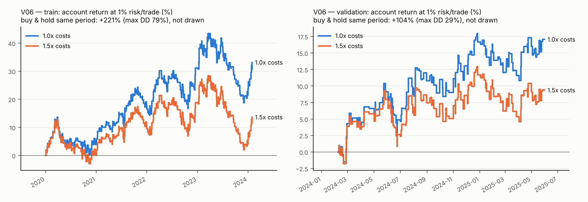
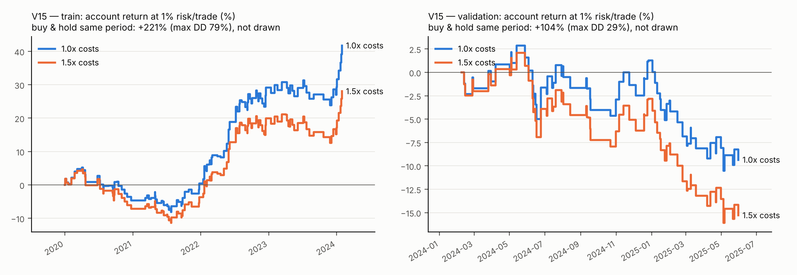
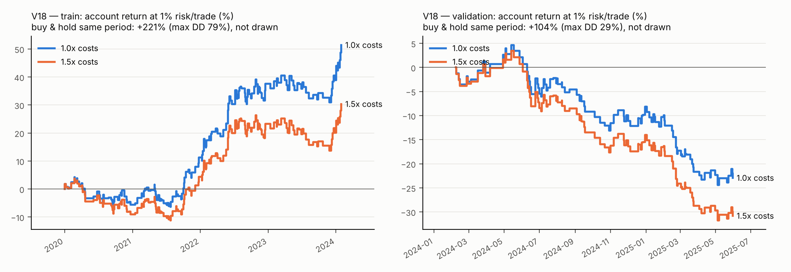

# Result tables (generated by scripts/make_report.py)

## All variants — train

| variant   |   mult |    n |   exp_R |   ci90_lo |   ci90_hi |   blk_ci90_lo |    pf |   win_rate |   max_dd_pct |   sharpe |   sortino |   lose_streak |   q_prof |   long_n |   long_exp |   short_n |   short_exp |   cost_R |   rand_mean |   rand_p |   bh_sharpe |
|:----------|-------:|-----:|--------:|----------:|----------:|--------------:|------:|-----------:|-------------:|---------:|----------:|--------------:|---------:|---------:|-----------:|----------:|------------:|---------:|------------:|---------:|------------:|
| V01       |  1.000 |  762 |  -0.246 |    -0.321 |    -0.171 |        -0.318 | 0.657 |      0.374 |       86.186 |   -2.603 |    -3.219 |            13 |    0.133 |      444 |     -0.212 |       318 |      -0.292 |    0.143 |      -0.168 |    0.967 |       0.770 |
| V01       |  1.500 |  762 |  -0.335 |    -0.412 |    -0.258 |        -0.410 | 0.570 |      0.366 |       92.974 |   -3.395 |    -3.982 |            13 |    0.067 |      444 |     -0.301 |       318 |      -0.382 |    0.213 |      -0.255 |    0.963 |       0.770 |
| V02       |  1.000 |  386 |  -0.276 |    -0.381 |    -0.168 |        -0.381 | 0.631 |      0.345 |       68.061 |   -2.143 |    -2.747 |            10 |    0.133 |      212 |     -0.169 |       174 |      -0.406 |    0.138 |      -0.174 |    0.967 |       0.770 |
| V02       |  1.500 |  386 |  -0.363 |    -0.469 |    -0.253 |        -0.470 | 0.553 |      0.342 |       76.962 |   -2.704 |    -3.291 |            10 |    0.067 |      212 |     -0.255 |       174 |      -0.494 |    0.207 |      -0.261 |    0.960 |       0.770 |
| V03       |  1.000 | 1955 |  -0.195 |    -0.240 |    -0.149 |        -0.235 | 0.710 |      0.394 |       98.130 |   -3.325 |    -4.008 |            12 |    0.000 |     1072 |     -0.198 |       883 |      -0.190 |    0.142 |      -0.170 |    0.824 |       0.770 |
| V03       |  1.500 | 1955 |  -0.283 |    -0.329 |    -0.237 |        -0.324 | 0.613 |      0.382 |       99.666 |   -4.617 |    -5.207 |            12 |    0.000 |     1072 |     -0.286 |       883 |      -0.279 |    0.213 |      -0.258 |    0.834 |       0.770 |
| V04       |  1.000 |  405 |   0.058 |    -0.047 |     0.166 |        -0.043 | 1.106 |      0.447 |       24.981 |    0.445 |     0.755 |             9 |    0.647 |      253 |      0.075 |       152 |       0.031 |    0.132 |      -0.169 |    0.003 |       0.770 |
| V04       |  1.500 |  405 |  -0.022 |    -0.129 |     0.087 |        -0.125 | 0.963 |      0.442 |       31.310 |   -0.166 |    -0.260 |             9 |    0.588 |      253 |     -0.011 |       152 |      -0.040 |    0.197 |      -0.257 |    0.003 |       0.770 |
| V05       |  1.000 | 2353 |  -0.145 |    -0.185 |    -0.105 |        -0.182 | 0.760 |      0.383 |       96.929 |   -2.756 |    -3.438 |            17 |    0.059 |     1135 |     -0.109 |      1218 |      -0.178 |    0.153 |      -0.182 |    0.076 |       0.770 |
| V05       |  1.500 | 2353 |  -0.240 |    -0.281 |    -0.199 |        -0.279 | 0.642 |      0.363 |       99.661 |   -4.376 |    -5.054 |            17 |    0.059 |     1135 |     -0.204 |      1218 |      -0.273 |    0.230 |      -0.273 |    0.120 |       0.770 |
| V06       |  1.000 |  384 |   0.081 |    -0.011 |     0.177 |        -0.016 | 1.181 |      0.451 |       17.220 |    0.686 |     1.196 |             6 |    0.588 |      235 |      0.098 |       149 |       0.054 |    0.072 |      -0.082 |    0.003 |       0.770 |
| V06       |  1.500 |  384 |   0.040 |    -0.054 |     0.136 |        -0.058 | 1.084 |      0.435 |       20.579 |    0.336 |     0.559 |             6 |    0.529 |      235 |      0.054 |       149 |       0.018 |    0.105 |      -0.126 |    0.003 |       0.770 |
| V07       |  1.000 |  688 |  -0.073 |    -0.113 |    -0.033 |        -0.113 | 0.755 |      0.496 |       41.044 |   -1.477 |    -1.796 |             6 |    0.200 |      400 |     -0.074 |       288 |      -0.071 |    0.049 |      -0.057 |    0.827 |       0.770 |
| V07       |  1.500 |  688 |  -0.103 |    -0.143 |    -0.062 |        -0.143 | 0.674 |      0.480 |       51.904 |   -2.034 |    -2.397 |             7 |    0.067 |      400 |     -0.104 |       288 |      -0.101 |    0.073 |      -0.086 |    0.844 |       0.770 |
| V08       |  1.000 | 2026 |  -0.207 |    -0.248 |    -0.166 |        -0.249 | 0.656 |      0.398 |       98.666 |   -3.859 |    -4.588 |            12 |    0.059 |     1081 |     -0.249 |       945 |      -0.158 |    0.156 |      -0.193 |    0.698 |       0.770 |
| V08       |  1.500 | 2026 |  -0.302 |    -0.344 |    -0.260 |        -0.347 | 0.547 |      0.373 |       99.794 |   -5.398 |    -5.998 |            14 |    0.000 |     1081 |     -0.341 |       945 |      -0.256 |    0.232 |      -0.286 |    0.721 |       0.770 |
| V09       |  1.000 |  155 |   0.126 |    -0.048 |     0.302 |        -0.043 | 1.230 |      0.490 |       10.375 |    0.572 |     0.995 |             4 |    0.667 |      108 |      0.110 |        47 |       0.161 |    0.134 |      -0.190 |    0.003 |       0.770 |
| V09       |  1.500 |  155 |   0.044 |    -0.132 |     0.223 |        -0.130 | 1.074 |      0.490 |       11.987 |    0.199 |     0.320 |             4 |    0.600 |      108 |      0.022 |        47 |       0.095 |    0.200 |      -0.279 |    0.003 |       0.770 |
| V10       |  1.000 |  192 |   0.038 |    -0.114 |     0.193 |        -0.119 | 1.069 |      0.422 |       14.588 |    0.206 |     0.341 |             8 |    0.600 |      105 |      0.096 |        87 |      -0.032 |    0.130 |      -0.175 |    0.003 |       0.770 |
| V10       |  1.500 |  192 |  -0.042 |    -0.197 |     0.114 |        -0.201 | 0.931 |      0.411 |       19.365 |   -0.228 |    -0.349 |             8 |    0.533 |      105 |      0.012 |        87 |      -0.107 |    0.195 |      -0.261 |    0.003 |       0.770 |
| V11       |  1.000 | 1640 |  -0.180 |    -0.228 |    -0.131 |        -0.225 | 0.716 |      0.399 |       95.491 |   -2.784 |    -3.535 |            10 |    0.133 |      906 |     -0.208 |       734 |      -0.144 |    0.147 |      -0.341 |    0.003 |       0.770 |
| V11       |  1.500 | 1640 |  -0.270 |    -0.319 |    -0.221 |        -0.317 | 0.610 |      0.382 |       98.979 |   -4.048 |    -4.783 |            13 |    0.067 |      906 |     -0.297 |       734 |      -0.237 |    0.219 |      -0.510 |    0.003 |       0.770 |
| V12       |  1.000 |  649 |  -0.136 |    -0.209 |    -0.064 |        -0.211 | 0.755 |      0.422 |       60.617 |   -1.439 |    -1.968 |            11 |    0.067 |      393 |     -0.137 |       256 |      -0.133 |    0.122 |      -0.332 |    0.003 |       0.770 |
| V12       |  1.500 |  649 |  -0.210 |    -0.284 |    -0.138 |        -0.287 | 0.651 |      0.401 |       75.730 |   -2.181 |    -2.804 |            16 |    0.067 |      393 |     -0.211 |       256 |      -0.209 |    0.182 |      -0.501 |    0.003 |       0.770 |
| V13       |  1.000 |  147 |   0.048 |    -0.108 |     0.210 |        -0.111 | 1.098 |      0.435 |       15.166 |    0.242 |     0.404 |            12 |    0.600 |      100 |      0.083 |        47 |      -0.026 |    0.073 |      -0.084 |    0.073 |       0.770 |
| V13       |  1.500 |  147 |   0.006 |    -0.151 |     0.169 |        -0.155 | 1.012 |      0.415 |       16.355 |    0.030 |     0.049 |            12 |    0.533 |      100 |      0.038 |        47 |      -0.061 |    0.108 |      -0.129 |    0.066 |       0.770 |
| V14       |  1.000 |  326 |   0.043 |    -0.068 |     0.157 |        -0.060 | 1.082 |      0.420 |       17.169 |    0.310 |     0.518 |             7 |    0.588 |      198 |      0.022 |       128 |       0.075 |    0.090 |      -0.120 |    0.020 |       0.770 |
| V14       |  1.500 |  326 |  -0.010 |    -0.123 |     0.105 |        -0.114 | 0.983 |      0.411 |       21.253 |   -0.071 |    -0.112 |             7 |    0.471 |      198 |     -0.036 |       128 |       0.031 |    0.135 |      -0.179 |    0.017 |       0.770 |
| V15       |  1.000 |  128 |   0.282 |     0.094 |     0.473 |         0.078 | 1.595 |      0.523 |       12.724 |    1.136 |     2.122 |             5 |    0.588 |       74 |      0.334 |        54 |       0.210 |    0.131 |      -0.172 |    0.003 |       0.770 |
| V15       |  1.500 |  128 |   0.202 |     0.012 |     0.397 |        -0.005 | 1.389 |      0.516 |       15.351 |    0.814 |     1.400 |             6 |    0.588 |       74 |      0.254 |        54 |       0.132 |    0.196 |      -0.260 |    0.003 |       0.770 |
| V16       |  1.000 |  277 |  -0.045 |    -0.169 |     0.082 |        -0.161 | 0.924 |      0.412 |       18.330 |   -0.306 |    -0.467 |             8 |    0.588 |      179 |     -0.032 |        98 |      -0.067 |    0.133 |      -0.177 |    0.010 |       0.770 |
| V16       |  1.500 |  277 |  -0.126 |    -0.252 |     0.003 |        -0.243 | 0.804 |      0.408 |       33.508 |   -0.835 |    -1.189 |             8 |    0.412 |      179 |     -0.121 |        98 |      -0.135 |    0.198 |      -0.264 |    0.010 |       0.770 |
| V17       |  1.000 |  351 |   0.051 |    -0.060 |     0.162 |        -0.063 | 1.096 |      0.430 |       23.484 |    0.372 |     0.603 |            10 |    0.471 |      195 |      0.141 |       156 |      -0.061 |    0.116 |      -0.174 |    0.003 |       0.770 |
| V17       |  1.500 |  351 |  -0.019 |    -0.132 |     0.092 |        -0.134 | 0.967 |      0.416 |       29.952 |   -0.134 |    -0.203 |            10 |    0.471 |      195 |      0.068 |       156 |      -0.128 |    0.173 |      -0.262 |    0.003 |       0.770 |
| V18       |  1.000 |  207 |   0.209 |     0.062 |     0.356 |         0.049 | 1.437 |      0.488 |       10.146 |    1.116 |     2.007 |             7 |    0.647 |      120 |      0.264 |        87 |       0.133 |    0.119 |      -0.172 |    0.003 |       0.770 |
| V18       |  1.500 |  207 |   0.137 |    -0.012 |     0.285 |        -0.024 | 1.262 |      0.478 |       14.464 |    0.727 |     1.215 |             7 |    0.647 |      120 |      0.190 |        87 |       0.063 |    0.178 |      -0.259 |    0.003 |       0.770 |
| V19       |  1.000 |  353 |   0.087 |    -0.016 |     0.189 |        -0.014 | 1.189 |      0.450 |       11.422 |    0.704 |     1.191 |             7 |    0.471 |      214 |      0.140 |       139 |       0.005 |    0.052 |      -0.043 |    0.010 |       0.770 |
| V19       |  1.500 |  353 |   0.059 |    -0.044 |     0.161 |        -0.042 | 1.124 |      0.439 |       12.669 |    0.478 |     0.785 |             7 |    0.412 |      214 |      0.111 |       139 |      -0.020 |    0.074 |      -0.072 |    0.010 |       0.770 |
| V20       |  1.000 |  373 |   0.115 |     0.004 |     0.226 |         0.012 | 1.250 |      0.440 |       16.360 |    0.870 |     1.642 |             6 |    0.588 |      224 |      0.160 |       149 |       0.048 |    0.075 |      -0.083 |    0.003 |       0.770 |
| V20       |  1.500 |  373 |   0.072 |    -0.039 |     0.184 |        -0.032 | 1.148 |      0.424 |       19.826 |    0.544 |     0.978 |             6 |    0.588 |      224 |      0.114 |       149 |       0.010 |    0.109 |      -0.127 |    0.003 |       0.770 |

## All variants — validation

| variant   |   mult |   n |   exp_R |   ci90_lo |   ci90_hi |   blk_ci90_lo |    pf |   win_rate |   max_dd_pct |   sharpe |   sortino |   lose_streak |   q_prof |   long_n |   long_exp |   short_n |   short_exp |   cost_R |   rand_mean |   rand_p |   bh_sharpe |
|:----------|-------:|----:|--------:|----------:|----------:|--------------:|------:|-----------:|-------------:|---------:|----------:|--------------:|---------:|---------:|-----------:|----------:|------------:|---------:|------------:|---------:|------------:|
| V01       |  1.000 |  46 |  -0.343 |    -0.625 |    -0.032 |        -0.688 | 0.555 |      0.326 |       18.067 |   -1.603 |    -2.225 |             6 |    0.333 |       32 |     -0.508 |        14 |       0.032 |    0.116 |      -0.179 |    0.837 |       1.300 |
| V01       |  1.500 |  46 |  -0.418 |    -0.704 |    -0.101 |        -0.771 | 0.498 |      0.304 |       20.753 |   -1.888 |    -2.481 |             6 |    0.167 |       32 |     -0.583 |        14 |      -0.040 |    0.174 |      -0.274 |    0.804 |       1.300 |
| V04       |  1.000 | 160 |  -0.058 |    -0.232 |     0.119 |        -0.199 | 0.911 |      0.419 |       20.149 |   -0.496 |    -0.750 |             7 |    0.500 |       92 |     -0.028 |        68 |      -0.099 |    0.148 |      -0.185 |    0.083 |       1.300 |
| V04       |  1.500 | 160 |  -0.150 |    -0.328 |     0.031 |        -0.294 | 0.792 |      0.406 |       28.583 |   -1.265 |    -1.771 |             7 |    0.333 |       92 |     -0.116 |        68 |      -0.195 |    0.222 |      -0.280 |    0.083 |       1.300 |
| V06       |  1.000 | 143 |   0.116 |    -0.038 |     0.271 |        -0.019 | 1.281 |      0.517 |        6.738 |    1.092 |     1.887 |             5 |    0.833 |       80 |      0.099 |        63 |       0.138 |    0.079 |      -0.084 |    0.023 |       1.300 |
| V06       |  1.500 | 143 |   0.069 |    -0.087 |     0.225 |        -0.069 | 1.156 |      0.503 |        7.713 |    0.641 |     1.051 |             6 |    0.667 |       80 |      0.052 |        63 |       0.090 |    0.117 |      -0.132 |    0.023 |       1.300 |
| V08       |  1.000 | 655 |  -0.105 |    -0.183 |    -0.025 |        -0.177 | 0.826 |      0.418 |       53.254 |   -1.776 |    -2.296 |             7 |    0.000 |      398 |     -0.142 |       257 |      -0.046 |    0.163 |      -0.197 |    0.040 |       1.300 |
| V08       |  1.500 | 655 |  -0.204 |    -0.284 |    -0.123 |        -0.277 | 0.695 |      0.395 |       75.541 |   -3.373 |    -4.053 |             9 |    0.000 |      398 |     -0.247 |       257 |      -0.138 |    0.243 |      -0.299 |    0.040 |       1.300 |
| V15       |  1.000 |  71 |  -0.131 |    -0.391 |     0.148 |        -0.365 | 0.812 |      0.394 |       13.020 |   -0.714 |    -1.031 |             6 |    0.167 |       38 |     -0.077 |        33 |      -0.194 |    0.154 |      -0.202 |    0.282 |       1.300 |
| V15       |  1.500 |  71 |  -0.227 |    -0.492 |     0.058 |        -0.468 | 0.704 |      0.380 |       17.828 |   -1.201 |    -1.620 |             6 |    0.167 |       38 |     -0.171 |        33 |      -0.290 |    0.230 |      -0.299 |    0.282 |       1.300 |
| V16       |  1.000 |  89 |   0.000 |    -0.235 |     0.245 |        -0.219 | 1.000 |      0.438 |       13.803 |    0.018 |     0.028 |             8 |    0.667 |       54 |      0.006 |        35 |      -0.009 |    0.144 |      -0.195 |    0.050 |       1.300 |
| V16       |  1.500 |  89 |  -0.088 |    -0.329 |     0.161 |        -0.315 | 0.870 |      0.427 |       17.331 |   -0.504 |    -0.737 |             8 |    0.333 |       54 |     -0.077 |        35 |      -0.105 |    0.215 |      -0.290 |    0.050 |       1.300 |
| V18       |  1.000 | 112 |  -0.225 |    -0.424 |    -0.027 |        -0.401 | 0.689 |      0.366 |       27.770 |   -1.544 |    -2.093 |             8 |    0.167 |       54 |     -0.244 |        58 |      -0.208 |    0.154 |      -0.177 |    0.698 |       1.300 |
| V18       |  1.500 | 112 |  -0.321 |    -0.523 |    -0.119 |        -0.502 | 0.596 |      0.357 |       34.055 |   -2.129 |    -2.715 |             8 |    0.000 |       54 |     -0.341 |        58 |      -0.303 |    0.230 |      -0.273 |    0.688 |       1.300 |

## Multiple-testing adjustment

Strategy variants tried: **20** (limit 25). Event-study tests: **64** (16 definitions x 4 horizons).
Variance of per-trade Sharpe across the 20 variants on Train: 0.01624.

| variant | split | n | exp R | per-trade SR | t | raw p (1-sided) | Bonferroni p (x variants) | Bonferroni p (x variants+event tests) | PSR(SR>0) | Deflated SR (N=variants) | Deflated SR (N=variants+tests) |
|---|---|---|---|---|---|---|---|---|---|---|---|
| V06 | train | 384 | +0.081 | +0.071 | +1.39 | 0.0834 | 1.000 | 1.000 | 0.920 | 0.000 | 0.000 |
| V06 | validation | 143 | +0.116 | +0.104 | +1.24 | 0.1076 | 1.000 | 1.000 | 0.897 | 0.047 | 0.005 |
| V15 | train | 128 | +0.282 | +0.212 | +2.39 | 0.0091 | 0.181 | 0.761 | 0.992 | 0.364 | 0.121 |
| V15 | validation | 71 | -0.131 | -0.097 | -0.82 | 0.7913 | 1.000 | 1.000 | 0.216 | 0.003 | 0.000 |
| V18 | train | 207 | +0.209 | +0.162 | +2.32 | 0.0105 | 0.211 | 0.886 | 0.991 | 0.120 | 0.013 |
| V18 | validation | 112 | -0.225 | -0.174 | -1.84 | 0.9658 | 1.000 | 1.000 | 0.043 | 0.000 | 0.000 |
| V20 | train | 373 | +0.115 | +0.089 | +1.72 | 0.0429 | 0.858 | 1.000 | 0.963 | 0.001 | 0.000 |

Deflated SR = probability that the true Sharpe exceeds the best Sharpe expected from N unskilled trials (Bailey & Lopez de Prado 2014). > 0.95 would be 'significant after selection'.

## V06 detail

`{"event": "h1_disp", "k_stop": 2.0, "rr": 2.0, "max_hold": 720}`

**V06 train 1.0x by year**

|   entry_time |       n |   exp_R |   total_R |   win_rate |
|-------------:|--------:|--------:|----------:|-----------:|
|         2020 |  88.000 |   0.050 |     4.381 |      0.386 |
|         2021 |  91.000 |   0.132 |    12.021 |      0.527 |
|         2022 |  93.000 |   0.134 |    12.439 |      0.462 |
|         2023 | 102.000 |  -0.069 |    -7.023 |      0.402 |
|         2024 |  10.000 |   0.929 |     9.294 |      0.700 |

**V06 train 1.0x by session**

| entry_time   |       n |   exp_R |   total_R |   win_rate |
|:-------------|--------:|--------:|----------:|-----------:|
| asia         |  99.000 |   0.160 |    15.799 |      0.455 |
| late         |  36.000 |   0.055 |     1.987 |      0.472 |
| london       |  74.000 |  -0.014 |    -1.068 |      0.432 |
| newyork      | 175.000 |   0.082 |    14.394 |      0.451 |

**V06 train 1.0x by side**

| dir   |       n |   exp_R |   total_R |   win_rate |
|:------|--------:|--------:|----------:|-----------:|
| long  | 235.000 |   0.098 |    23.016 |      0.447 |
| short | 149.000 |   0.054 |     8.096 |      0.456 |

**V06 train 1.0x by reason**

| reason   |       n |   exp_R |   total_R |   win_rate |
|:---------|--------:|--------:|----------:|-----------:|
| stop     | 130.000 |  -1.107 |  -143.873 |      0.000 |
| target   |  76.000 |   1.940 |   147.438 |      1.000 |
| time     | 178.000 |   0.155 |    27.547 |      0.545 |

**V06 train 1.0x by quarter**

| exit_time   |      n |   exp_R |   total_R |   win_rate |
|:------------|-------:|--------:|----------:|-----------:|
| 2020Q1      | 21.000 |   0.516 |    10.842 |      0.571 |
| 2020Q2      | 20.000 |  -0.236 |    -4.718 |      0.250 |
| 2020Q3      | 23.000 |  -0.096 |    -2.217 |      0.348 |
| 2020Q4      | 24.000 |   0.020 |     0.474 |      0.375 |
| 2021Q1      | 13.000 |   0.484 |     6.295 |      0.692 |
| 2021Q2      | 23.000 |   0.160 |     3.671 |      0.522 |
| 2021Q3      | 34.000 |   0.178 |     6.048 |      0.559 |
| 2021Q4      | 21.000 |  -0.190 |    -3.994 |      0.381 |
| 2022Q1      | 25.000 |   0.370 |     9.241 |      0.560 |
| 2022Q2      | 20.000 |   0.063 |     1.257 |      0.450 |
| 2022Q3      | 24.000 |  -0.324 |    -7.778 |      0.292 |
| 2022Q4      | 24.000 |   0.405 |     9.719 |      0.542 |
| 2023Q1      | 32.000 |   0.288 |     9.201 |      0.531 |
| 2023Q2      | 33.000 |  -0.096 |    -3.161 |      0.394 |
| 2023Q3      | 16.000 |  -0.537 |    -8.589 |      0.188 |
| 2023Q4      | 21.000 |  -0.213 |    -4.473 |      0.381 |
| 2024Q1      | 10.000 |   0.929 |     9.294 |      0.700 |

**V06 validation 1.0x by year**

|   entry_time |      n |   exp_R |   total_R |   win_rate |
|-------------:|-------:|--------:|----------:|-----------:|
|         2024 | 94.000 |   0.171 |    16.085 |      0.532 |
|         2025 | 49.000 |   0.011 |     0.559 |      0.490 |

**V06 validation 1.0x by session**

| entry_time   |      n |   exp_R |   total_R |   win_rate |
|:-------------|-------:|--------:|----------:|-----------:|
| asia         | 25.000 |   0.313 |     7.814 |      0.600 |
| late         | 12.000 |   0.498 |     5.974 |      0.750 |
| london       | 20.000 |   0.096 |     1.911 |      0.450 |
| newyork      | 86.000 |   0.011 |     0.945 |      0.477 |

**V06 validation 1.0x by side**

| dir   |      n |   exp_R |   total_R |   win_rate |
|:------|-------:|--------:|----------:|-----------:|
| long  | 80.000 |   0.099 |     7.948 |      0.512 |
| short | 63.000 |   0.138 |     8.695 |      0.524 |

**V06 validation 1.0x by reason**

| reason   |      n |   exp_R |   total_R |   win_rate |
|:---------|-------:|--------:|----------:|-----------:|
| stop     | 46.000 |  -1.126 |   -51.789 |      0.000 |
| target   | 26.000 |   1.933 |    50.252 |      1.000 |
| time     | 71.000 |   0.256 |    18.181 |      0.676 |

**V06 validation 1.0x by quarter**

| exit_time   |      n |   exp_R |   total_R |   win_rate |
|:------------|-------:|--------:|----------:|-----------:|
| 2024Q1      | 15.000 |   0.274 |     4.108 |      0.533 |
| 2024Q2      | 24.000 |   0.038 |     0.910 |      0.500 |
| 2024Q3      | 31.000 |   0.190 |     5.876 |      0.548 |
| 2024Q4      | 24.000 |   0.216 |     5.190 |      0.542 |
| 2025Q1      | 28.000 |  -0.155 |    -4.348 |      0.429 |
| 2025Q2      | 21.000 |   0.234 |     4.907 |      0.571 |

## V15 detail

`{"event": "h1_disp_lead", "event_kw": {"lead": "spot"}, "k_stop": 1.0, "rr": 2.0, "max_hold": 240}`

**V15 train 1.0x by year**

|   entry_time |      n |   exp_R |   total_R |   win_rate |
|-------------:|-------:|--------:|----------:|-----------:|
|         2020 | 30.000 |  -0.151 |    -4.526 |      0.433 |
|         2021 | 27.000 |   0.199 |     5.367 |      0.556 |
|         2022 | 43.000 |   0.594 |    25.563 |      0.581 |
|         2023 | 22.000 |  -0.066 |    -1.455 |      0.364 |
|         2024 |  6.000 |   1.854 |    11.122 |      1.000 |

**V15 train 1.0x by session**

| entry_time   |      n |   exp_R |   total_R |   win_rate |
|:-------------|-------:|--------:|----------:|-----------:|
| asia         | 32.000 |   0.239 |     7.661 |      0.500 |
| late         |  4.000 |  -0.290 |    -1.161 |      0.250 |
| london       | 27.000 |  -0.037 |    -1.002 |      0.407 |
| newyork      | 65.000 |   0.470 |    30.571 |      0.600 |

**V15 train 1.0x by side**

| dir   |      n |   exp_R |   total_R |   win_rate |
|:------|-------:|--------:|----------:|-----------:|
| long  | 74.000 |   0.334 |    24.725 |      0.554 |
| short | 54.000 |   0.210 |    11.345 |      0.481 |

**V15 train 1.0x by reason**

| reason   |      n |   exp_R |   total_R |   win_rate |
|:---------|-------:|--------:|----------:|-----------:|
| stop     | 46.000 |  -1.203 |   -55.339 |      0.000 |
| target   | 43.000 |   1.880 |    80.844 |      1.000 |
| time     | 39.000 |   0.271 |    10.565 |      0.615 |

**V15 train 1.0x by quarter**

| exit_time   |      n |   exp_R |   total_R |   win_rate |
|:------------|-------:|--------:|----------:|-----------:|
| 2020Q1      |  6.000 |   0.785 |     4.707 |      0.667 |
| 2020Q2      |  7.000 |  -0.277 |    -1.942 |      0.429 |
| 2020Q3      | 11.000 |  -0.152 |    -1.670 |      0.455 |
| 2020Q4      |  6.000 |  -0.937 |    -5.621 |      0.167 |
| 2021Q1      |  3.000 |   0.145 |     0.435 |      0.667 |
| 2021Q2      |  8.000 |  -0.234 |    -1.872 |      0.375 |
| 2021Q3      | 11.000 |   0.210 |     2.311 |      0.545 |
| 2021Q4      |  5.000 |   0.899 |     4.494 |      0.800 |
| 2022Q1      | 12.000 |   0.657 |     7.886 |      0.667 |
| 2022Q2      |  6.000 |   1.523 |     9.139 |      0.833 |
| 2022Q3      | 13.000 |   0.358 |     4.648 |      0.462 |
| 2022Q4      | 12.000 |   0.324 |     3.891 |      0.500 |
| 2023Q1      |  4.000 |   0.333 |     1.331 |      0.500 |
| 2023Q2      |  8.000 |  -0.164 |    -1.313 |      0.250 |
| 2023Q3      |  5.000 |  -0.294 |    -1.472 |      0.400 |
| 2023Q4      |  5.000 |  -0.000 |    -0.002 |      0.400 |
| 2024Q1      |  6.000 |   1.854 |    11.122 |      1.000 |

**V15 validation 1.0x by year**

|   entry_time |      n |   exp_R |   total_R |   win_rate |
|-------------:|-------:|--------:|----------:|-----------:|
|         2024 | 44.000 |   0.035 |     1.528 |      0.455 |
|         2025 | 27.000 |  -0.402 |   -10.845 |      0.296 |

**V15 validation 1.0x by session**

| entry_time   |      n |   exp_R |   total_R |   win_rate |
|:-------------|-------:|--------:|----------:|-----------:|
| asia         |  9.000 |   0.393 |     3.534 |      0.556 |
| late         |  5.000 |   0.827 |     4.133 |      0.600 |
| london       | 11.000 |  -0.239 |    -2.628 |      0.364 |
| newyork      | 46.000 |  -0.312 |   -14.356 |      0.348 |

**V15 validation 1.0x by side**

| dir   |      n |   exp_R |   total_R |   win_rate |
|:------|-------:|--------:|----------:|-----------:|
| long  | 38.000 |  -0.077 |    -2.918 |      0.421 |
| short | 33.000 |  -0.194 |    -6.398 |      0.364 |

**V15 validation 1.0x by reason**

| reason   |      n |   exp_R |   total_R |   win_rate |
|:---------|-------:|--------:|----------:|-----------:|
| stop     | 37.000 |  -1.238 |   -45.802 |      0.000 |
| target   | 19.000 |   1.857 |    35.278 |      1.000 |
| time     | 15.000 |   0.080 |     1.207 |      0.600 |

**V15 validation 1.0x by quarter**

| exit_time   |      n |   exp_R |   total_R |   win_rate |
|:------------|-------:|--------:|----------:|-----------:|
| 2024Q1      |  6.000 |  -0.149 |    -0.896 |      0.333 |
| 2024Q2      | 14.000 |  -0.050 |    -0.695 |      0.429 |
| 2024Q3      | 14.000 |  -0.167 |    -2.343 |      0.429 |
| 2024Q4      | 10.000 |   0.546 |     5.462 |      0.600 |
| 2025Q1      | 16.000 |  -0.603 |    -9.641 |      0.250 |
| 2025Q2      | 11.000 |  -0.109 |    -1.204 |      0.364 |

## V18 detail

`{"event": "h1_disp_lead_k", "event_kw": {"lead": "spot", "k": 2.0}, "k_stop": 1.0, "rr": 2.0, "max_hold": 240}`

**V18 train 1.0x by year**

|   entry_time |      n |   exp_R |   total_R |   win_rate |
|-------------:|-------:|--------:|----------:|-----------:|
|         2020 | 47.000 |  -0.115 |    -5.395 |      0.447 |
|         2021 | 55.000 |   0.307 |    16.879 |      0.527 |
|         2022 | 64.000 |   0.340 |    21.758 |      0.500 |
|         2023 | 33.000 |   0.036 |     1.201 |      0.394 |
|         2024 |  8.000 |   1.102 |     8.818 |      0.750 |

**V18 train 1.0x by session**

| entry_time   |       n |   exp_R |   total_R |   win_rate |
|:-------------|--------:|--------:|----------:|-----------:|
| asia         |  47.000 |   0.159 |     7.460 |      0.468 |
| late         |   8.000 |   0.084 |     0.669 |      0.375 |
| london       |  47.000 |   0.151 |     7.087 |      0.447 |
| newyork      | 105.000 |   0.267 |    28.045 |      0.524 |

**V18 train 1.0x by side**

| dir   |       n |   exp_R |   total_R |   win_rate |
|:------|--------:|--------:|----------:|-----------:|
| long  | 120.000 |   0.264 |    31.661 |      0.525 |
| short |  87.000 |   0.133 |    11.600 |      0.437 |

**V18 train 1.0x by reason**

| reason   |      n |   exp_R |   total_R |   win_rate |
|:---------|-------:|--------:|----------:|-----------:|
| stop     | 76.000 |  -1.176 |   -89.386 |      0.000 |
| target   | 63.000 |   1.884 |   118.685 |      1.000 |
| time     | 68.000 |   0.205 |    13.963 |      0.559 |

**V18 train 1.0x by quarter**

| exit_time   |      n |   exp_R |   total_R |   win_rate |
|:------------|-------:|--------:|----------:|-----------:|
| 2020Q1      | 10.000 |   0.166 |     1.661 |      0.500 |
| 2020Q2      |  9.000 |  -0.269 |    -2.417 |      0.444 |
| 2020Q3      | 15.000 |  -0.122 |    -1.833 |      0.400 |
| 2020Q4      | 13.000 |  -0.216 |    -2.807 |      0.462 |
| 2021Q1      | 12.000 |   0.427 |     5.119 |      0.583 |
| 2021Q2      | 15.000 |  -0.312 |    -4.684 |      0.267 |
| 2021Q3      | 16.000 |   0.244 |     3.904 |      0.562 |
| 2021Q4      | 12.000 |   1.045 |    12.541 |      0.750 |
| 2022Q1      | 17.000 |   0.511 |     8.693 |      0.647 |
| 2022Q2      | 11.000 |   0.662 |     7.277 |      0.545 |
| 2022Q3      | 20.000 |   0.087 |     1.739 |      0.400 |
| 2022Q4      | 16.000 |   0.253 |     4.050 |      0.438 |
| 2023Q1      |  7.000 |   0.137 |     0.959 |      0.429 |
| 2023Q2      | 12.000 |  -0.180 |    -2.156 |      0.250 |
| 2023Q3      |  7.000 |  -0.146 |    -1.021 |      0.429 |
| 2023Q4      |  7.000 |   0.489 |     3.420 |      0.571 |
| 2024Q1      |  8.000 |   1.102 |     8.818 |      0.750 |

**V18 validation 1.0x by year**

|   entry_time |      n |   exp_R |   total_R |   win_rate |
|-------------:|-------:|--------:|----------:|-----------:|
|         2024 | 70.000 |  -0.115 |    -8.061 |      0.414 |
|         2025 | 42.000 |  -0.409 |   -17.177 |      0.286 |

**V18 validation 1.0x by session**

| entry_time   |      n |   exp_R |   total_R |   win_rate |
|:-------------|-------:|--------:|----------:|-----------:|
| asia         | 18.000 |   0.046 |     0.834 |      0.444 |
| late         |  7.000 |   0.308 |     2.159 |      0.429 |
| london       | 14.000 |  -0.101 |    -1.412 |      0.429 |
| newyork      | 73.000 |  -0.367 |   -26.819 |      0.329 |

**V18 validation 1.0x by side**

| dir   |      n |   exp_R |   total_R |   win_rate |
|:------|-------:|--------:|----------:|-----------:|
| long  | 54.000 |  -0.244 |   -13.196 |      0.370 |
| short | 58.000 |  -0.208 |   -12.043 |      0.362 |

**V18 validation 1.0x by reason**

| reason   |      n |   exp_R |   total_R |   win_rate |
|:---------|-------:|--------:|----------:|-----------:|
| stop     | 60.000 |  -1.235 |   -74.122 |      0.000 |
| target   | 25.000 |   1.863 |    46.565 |      1.000 |
| time     | 27.000 |   0.086 |     2.319 |      0.593 |

**V18 validation 1.0x by quarter**

| exit_time   |      n |   exp_R |   total_R |   win_rate |
|:------------|-------:|--------:|----------:|-----------:|
| 2024Q1      | 10.000 |  -0.098 |    -0.983 |      0.400 |
| 2024Q2      | 19.000 |  -0.172 |    -3.260 |      0.368 |
| 2024Q3      | 23.000 |  -0.221 |    -5.074 |      0.435 |
| 2024Q4      | 18.000 |   0.070 |     1.256 |      0.444 |
| 2025Q1      | 28.000 |  -0.562 |   -15.736 |      0.250 |
| 2025Q2      | 14.000 |  -0.103 |    -1.441 |      0.357 |

## 1H-displacement-follow family: Train vs Validation vs pooled (descriptive; validation already seen)

| variant | mult | train n | train exp R | val n | val exp R | pooled n | pooled exp R [90% CI] |
|---|---|---|---|---|---|---|---|
| V04 | 1.0 | 405 | +0.058 | 160 | -0.058 | 565 | +0.025 [-0.066,+0.114] |
| V04 | 1.5 | 405 | -0.022 | 160 | -0.150 | 565 | -0.058 [-0.151,+0.032] |
| V06 | 1.0 | 384 | +0.081 | 143 | +0.116 | 527 | +0.091 [+0.009,+0.173] |
| V06 | 1.5 | 384 | +0.040 | 143 | +0.069 | 527 | +0.048 [-0.035,+0.131] |
| V19 | 1.0 | 353 | +0.087 | 133 | +0.128 | 486 | +0.098 [+0.013,+0.184] |
| V19 | 1.5 | 353 | +0.059 | 133 | +0.097 | 486 | +0.070 [-0.016,+0.156] |
| V20 | 1.0 | 373 | +0.115 | 141 | +0.105 | 514 | +0.112 [+0.021,+0.205] |
| V20 | 1.5 | 373 | +0.072 | 141 | +0.056 | 514 | +0.068 [-0.025,+0.161] |
